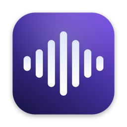
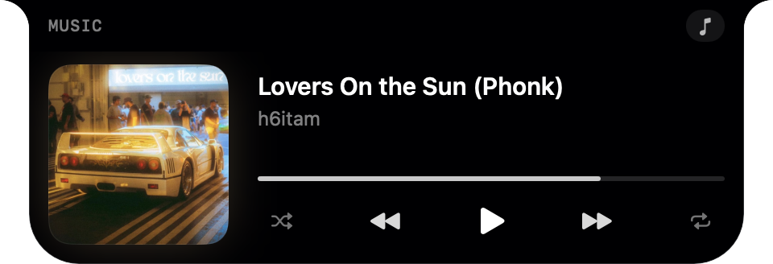
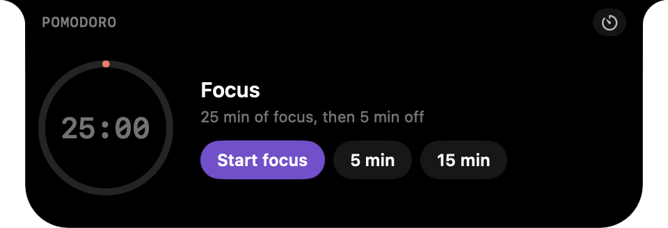

<div align="center">
  
  <h1>VoxOS</h1>
  <p>A native macOS voice dictation + voice-to-action agent, for personal use</p>

  [](https://github.com/achyuthkp27/VoxOs/actions/workflows/ci.yml)
  [](https://www.gnu.org/licenses/gpl-3.0)
  
</div>

---

VoxOS is a native macOS voice dictation and voice-to-action agent, built for my own day-to-day use —
not distributed or sold.

It does three things:

1. **Dictation** — hold a shortcut, speak, and it transcribes locally (Whisper / Parakeet) and pastes cleaned-up
   text wherever your cursor is.
2. **Agent Mode** — hold a different shortcut, speak a request, and it acts on your Mac: add calendar events,
   set reminders, draft emails, send WhatsApp/Slack/iMessage messages, find files, open apps and URLs, and more,
   using a provider-agnostic JSON tool-calling loop (works with local Ollama, Local CLI, or any hosted provider).
3. **The notch** — between dictations the MacBook's notch becomes a small home for the things you glance at:
   music, your calendar, the weather, reminders, a Pomodoro timer, a file shelf and sound controls, plus
   Claude Code's requests, all a hover away.

## The notch

Push the pointer to the top of the notch, or drag a file toward it, and it opens into a card whose pages you
swipe between. The rest of the time it stays the size of the notch and shows one thing at a time.

**Pages, when it is open**

- 🎵 **Music** — the cover, the title and "Artist — Album", the lyric under way or the track's format
  (Lossless, Hi-Res Lossless, Dolby Atmos), and its position; the star (Apple Music favourites), shuffle,
  previous, play/pause, next and repeat; and a list with **Up Next** — the queue, numbered, a double-click
  plays one — and **Output**, to send the sound to another device. In a track's last seconds it says what
  is up next. Apple Music, Spotify and any app macOS reports as playing; dots switch between players. Live
  Music Bars move with the actual audio when switched on.
- 📅 **Calendar** — the date and the weather, the next events with **Join** for a video call, and under
  them your reminders, ticked off from the notch.
- 🌤️ **Weather** — the place and when it was read; the temperature with the conditions and today's high and
  low; rain chance, humidity, feels like and wind; and the next five days, each with its chance of rain and
  its range as a bar on the week's, coloured by temperature. Open-Meteo, no key or account.
- 🍅 **Pomodoro** — a ring with the time and the sessions done, and Start, Pause and Reset; start a focus,
  a short break or a long break, whichever you want. Settings for each length, how many sessions come before a
  long break (or none), the sound, and whether the next session starts on its own. Plain timers start by voice.
- 🗂️ **Shelf** — drop files on the notch to keep them at hand; open, copy, zip, reveal or remove them.
- 🔊 **Sound** — each playing app's own volume, clipboard history, a camera mirror, keeping
  the Mac awake, and pinning the card open.

**One thing at a time, when it is closed**

- The playing track with its cover and bars, a running timer, or a download's progress.
- The next meeting, counting down, with **Join**.
- Another app using the microphone or camera; a click on the microphone mutes it.
- Volume and brightness, in place of macOS's own pop-up.
- A short notice when something happens: a Bluetooth device or Wi-Fi connects or drops, the sound moves to
  another output, the charger is plugged in or the battery runs low, a timer ends, rain is due within two
  hours, a Focus mode comes on, or an app's unread count goes up.

**Claude Code and other CLIs**

- Allow or deny a Claude Code session's requests, answer its questions and approve its plans from the notch,
  through local hooks. See when a session is working, its reply when a turn ends (read aloud if you like),
  your usage limits and costs, and the CI result after a push. Codex turns, and Gemini CLI turns and
  approvals, show there too.

**Everything else**

- Hold the notch to ask the Agent. Liquid Glass or solid black. Hidden from screenshots and screen sharing if
  you want. Follows the display in use, and optionally stays in full screen. Every part has its own switch in
  Settings → Notch, and nothing that needs a permission asks for it before you open its page.

## Features

- 🎙️ **Local transcription** — Whisper.cpp / Parakeet models, fully offline
- 🤖 **Agent Mode** — 90+ voice-triggered tools: calendar, reminders, notes, mail drafts, WhatsApp, Slack,
  Linear, iMessage, memory, system utilities — plus full **computer control**: click UI by name through the
  Accessibility tree, OCR and on-screen set-of-marks ("click 7"), synthetic mouse/keyboard, window management,
  shell and AppleScript behind a risk gate, files and PDFs, browser DOM control, macros ("teach it a skill"),
  JSON plugins the agent can write and repair itself, screen/audio watchers, and control modes
  (act freely / ask before acting / observe only)
- 🔊 **System audio** — `⌃/` captures what the Mac is playing (never the mic), transcribes it, copies and
  pastes it; `⌃⇧/` transcribes the last N seconds from a rolling buffer; also callable by the agent
- 🪟 **Liquid Glass UI** — macOS Tahoe glass throughout: floating sidebar, glass cards, translucent notch panel,
  left-edge history card (hover the screen edge, click the notch, pin with the lock)
- ⚡ **One-click Agent setup** — a quick-install button wires up a working AI provider, the built-in Agent
  prompt, and a Control+Option hold-to-talk shortcut automatically
- 🧠 **Modes** — per-app/per-URL configuration for transcription + AI enhancement behavior
- 🔒 **Privacy-first** — transcription is always local; the agent loop can run entirely on-device via Ollama
- 🖥️ **Notch-docked recorder UI** — a compact panel that molds around the camera notch, with a left-edge
  hover history sidebar for past interactions
- 🎵 **Notch Home** — between dictations the notch opens into a small card: the playing track with its
  controls, Calendar, Weather, Reminders, a Pomodoro timer, a file shelf, and per-app volume; collapsed, it
  shows one thing at a time (a track, a timer, a meeting countdown, a download, volume and brightness)
- 🧩 **Claude Code in the notch** — allow or deny a session's requests, answer its questions and approve its
  plans from the notch, through local hooks; it also says when a push's CI run ends, and when a Codex or
  Gemini CLI turn ends

## Screenshots

<p align="center">
  
  <br />
  
</p>

## Build

`make local` builds, signs with your Apple Development identity and installs to `/Applications`;
`make dev` does both build and launch. Run `make help` for the full target list.

See [BUILDING.md](BUILDING.md) for the general build instructions. This fork additionally requires:

```shell
xcodebuild -project VoxOS.xcodeproj -scheme VoxOS -configuration Debug \
  -derivedDataPath "$PWD/.local-build" \
  -xcconfig LocalBuild.xcconfig \
  -skipPackagePluginValidation -skipMacroValidation \
  CODE_SIGN_IDENTITY="-" CODE_SIGNING_REQUIRED=NO CODE_SIGNING_ALLOWED=YES \
  DEVELOPMENT_TEAM="" \
  CODE_SIGN_ENTITLEMENTS="$PWD/VoxOS/VoxOS.local.entitlements" \
  SWIFT_ACTIVE_COMPILATION_CONDITIONS='$(inherited) LOCAL_BUILD' \
  build
```

(Needs the Metal toolchain installed once via `xcodebuild -downloadComponent MetalToolchain`.)

## Development

| command | what it does |
| --- | --- |
| `make local` | Build, sign, install to `/Applications` |
| `make dev` | `make local` then launch |
| `make test` | Run the test suite (72 tests) |
| `make lint` | Check formatting with swift-format |
| `make format` | Reformat sources in place |

`make test` scores the run from its `.xcresult` bundle rather than the xcodebuild console,
so it reports every test and fails the build when any of them fail:

```
Passed: 71 passed, 0 failed, 1 skipped (72 total)
```

The skipped test is a live MCP check; enable it with `TEST_RUNNER_VOXOS_LIVE_MCP=1 make test`.
The full xcodebuild log is written to `.local-build-tests/test.log`.

Formatting is enforced by [`.swift-format`](.swift-format). Two rules are deliberately off:
`AlwaysUseLowerCamelCase`, because it cannot tell a `Codable` property whose name is a
wire-format JSON key from a badly named constant, and `ReplaceForEachWithForLoop`, which is
a style opinion with no behavioural effect.

The tree was reformatted in one sweep; [`.git-blame-ignore-revs`](.git-blame-ignore-revs) keeps
that commit out of `git blame`. Enable it locally with:

```shell
git config blame.ignoreRevsFile .git-blame-ignore-revs
```

### Continuous integration

[`.github/workflows/ci.yml`](.github/workflows/ci.yml) runs `make test` and `make lint` on a
clean macOS runner for every push and pull request. The whisper.xcframework is cached against
the pinned `WHISPER_CPP_REF` in the [Makefile](Makefile), so only the first run pays for
building it.

Dependencies are pinned by revision rather than tracking branches, and `Package.resolved` is
committed, so every machine and CI build the same tree.

## Requirements

- macOS 14.4 or later

## License

Licensed under the GNU General Public License v3.0 — see [LICENSE](LICENSE).

## Acknowledgments

- [whisper.cpp](https://github.com/ggerganov/whisper.cpp) — Whisper model inference
- [FluidAudio](https://github.com/FluidInference/FluidAudio) — Parakeet model implementation
- [TranscribeCpp for Swift](https://github.com/Beingpax/Transcribe-cpp-swift) — local GGUF transcription models
- [SenseVoice Small](https://huggingface.co/FunAudioLLM/SenseVoiceSmall) — multilingual model
- [Sparkle](https://github.com/sparkle-project/Sparkle), [KeyboardShortcuts](https://github.com/sindresorhus/KeyboardShortcuts),
  [LaunchAtLogin](https://github.com/sindresorhus/LaunchAtLogin), [MediaRemoteAdapter](https://github.com/ejbills/mediaremote-adapter),
  [Zip](https://github.com/marmelroy/Zip), [SelectedTextKit](https://github.com/tisfeng/SelectedTextKit),
  [Swift Atomics](https://github.com/apple/swift-atomics)

---

Personal project by Achyuth KP.
